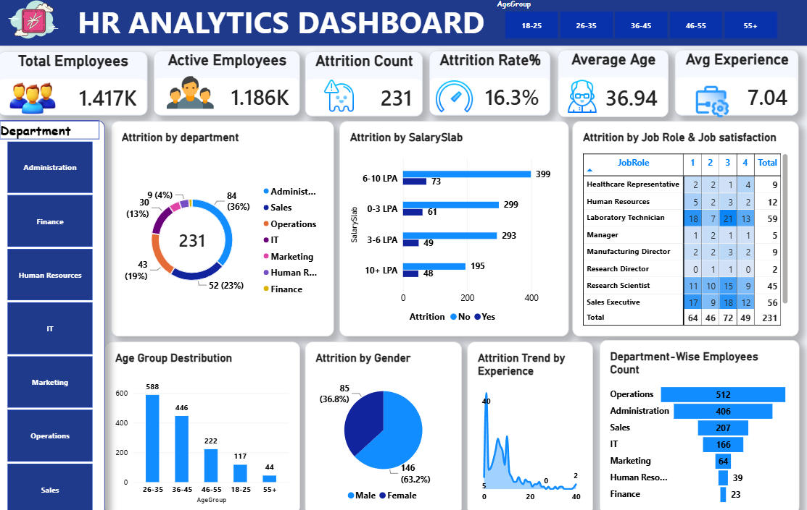

# 📊 HR Analytics Dashboard | Employee Attrition Analysis

## 📌 Project Overview

The **HR Analytics Dashboard** is a data analysis and visualization project designed to analyze employee demographics, workforce distribution, job satisfaction, salary levels, and employee attrition.

The goal is to transform HR data into meaningful insights that help HR teams understand workforce trends, identify attrition patterns, and support data-driven decision-making.

## 🖥️ Dashboard Preview



*Interactive HR dashboard showing workforce KPIs, attrition breakdowns, employee demographics, job satisfaction, and department-wise headcount.*

## 🎯 Business Objectives

- Monitor key workforce metrics and HR performance indicators.
- Analyze employee attrition across departments and salary levels.
- Explore workforce demographics by age group and gender.
- Evaluate job satisfaction across different job roles.
- Support evidence-based investigation of employee retention challenges.

## 📈 Key Performance Indicators (KPIs)

| KPI | Value |
|---|---:|
| Total Employees | 1,417 |
| Active Employees | 1,186 |
| Attrition Count | 231 |
| Attrition Rate | 16.3% |
| Average Age | 36.94 years |
| Average Experience | 7.04 years |

**Key observation:** The dashboard reports an attrition rate of 16.3%. This is a descriptive metric and does not, by itself, explain why employees leave.

## 📊 Dashboard Features

### 1. Department Filter
Filter the dashboard by department to explore department-specific workforce and attrition metrics.

### 2. Attrition by Department
Compares employee attrition counts across departments and helps identify areas for further investigation.

### 3. Attrition by Salary Slab
Compares attrition across salary categories to explore patterns related to compensation levels.

### 4. Attrition by Job Role and Job Satisfaction
Displays job satisfaction ratings across job roles, supporting analysis of employee experience.

### 5. Age Group Distribution
Shows the distribution of employees across the following age groups:
- 18–25
- 26–35
- 36–45
- 46–55
- 55+

### 6. Attrition by Gender
Compares the displayed attrition counts by gender.

### 7. Attrition Trend by Experience
Explores how attrition is distributed across employee experience levels.

### 8. Department-Wise Employee Count
Compares workforce size across departments to support headcount analysis and resource planning.

## 🔍 Key Observations

Based on the dashboard screenshot:

- **Workforce size:** The dashboard reports 1,417 total employees and 1,186 active employees.
- **Attrition:** The dashboard reports 231 employees in the attrition count and an attrition rate of 16.3%.
- **Age distribution:** The 26–35 age group is the largest displayed age group.
- **Department size:** Operations has the largest displayed workforce, followed by Administration and Sales.
- **Salary analysis:** The 6–10 LPA salary slab has the highest displayed attrition count among the salary categories.
- **Gender analysis:** The displayed attrition count is higher for male employees than for female employees.

These are descriptive observations from the dashboard. Further analysis is required to establish causes or determine whether differences are statistically meaningful.

## 🛠️ Tools & Technologies

Update this list to reflect the tools actually used in the project.

- **Data analysis:** Data cleaning, exploratory data analysis (EDA), KPI analysis
- **Data visualization:** Power BI / Tableau / Excel
- **Data preparation:** Excel / Python / Power Query / SQL
- **Reporting:** Interactive dashboard, filters, and visual analytics

## 📂 Repository Structure

```text
HR-Analytics-Dashboard/
├── README.md
├── dashboard.png
├── data/
│   └── hr_data.csv
├── reports/
│   └── HR_Analytics_Dashboard.pdf
└── LICENSE
```

The `data/`, `reports/`, and `LICENSE` entries are examples. Include them only if those files exist in your repository. Keep `README.md` and `dashboard.png` together in the repository root so the screenshot displays correctly.

## 🚀 How to Use This Project

1. Clone or download this repository.
2. Open the dashboard in the visualization software used to build it.
3. Use the department filter to explore different parts of the organization.
4. Review the KPI cards for an overview of workforce metrics.
5. Compare attrition, salary categories, demographics, job satisfaction, experience, and department headcount.

## 💡 Potential Business Recommendations

After validating the findings against the underlying data, HR teams could:

- Investigate departments with relatively high attrition rates.
- Review compensation competitiveness across salary levels.
- Examine job satisfaction patterns across different roles.
- Develop and evaluate employee retention initiatives.
- Monitor attrition alongside tenure, experience, and other relevant factors.

## ⚠️ Limitations

- The dashboard provides descriptive analysis and does not establish causal relationships.
- Findings depend on the quality and completeness of the underlying dataset.
- Demographic and role-based comparisons should be interpreted carefully and used responsibly.
- Validate KPI definitions and calculations against the source data before using them for business decisions.

## 🔮 Future Improvements

- Add monthly and yearly attrition trend analysis.
- Include employee tenure and performance analysis.
- Build an employee attrition prediction model using machine learning.
- Develop employee retention risk segmentation.
- Add automated data refresh and KPI reporting.

## 👨‍💻 Author

**Abdelrahman Emad**

Computer Science Graduate | Data Analyst | AI & Machine Learning Enthusiast

- **GitHub:** [Add your GitHub profile URL](https://github.com/)
- **LinkedIn:** [Add your LinkedIn profile URL](https://www.linkedin.com/)

## ⭐ Support

If you find this project useful, consider giving the repository a ⭐ on GitHub.

---

*Created for portfolio development and to demonstrate practical HR analytics and data visualization skills.*
